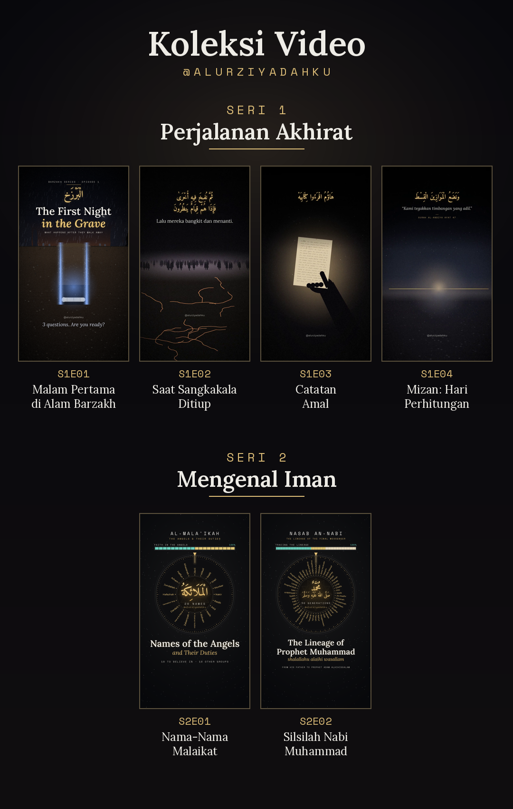

# Koleksi Video @alurziyadahku



Kode episode: **S** = seri, **E** = episode. Contoh: `S1E03` = Seri 1, Episode 3.

---

## SERI 1 — Perjalanan Akhirat
Urutan mengikuti perjalanan setelah kematian: kubur → kebangkitan → catatan amal → timbangan.

| Kode | Judul | Durasi | Narasi | Cover | Caption | Hook + end card |
|---|---|---|---|---|---|---|
| **S1E01** | Malam Pertama di Alam Barzakh | 2:11 | teks layar | ✅ EN | ✅ EN | — |
| **S1E02** | Saat Sangkakala Ditiup | 1:51 | voice-over EN | — | — | — |
| **S1E03** | Catatan Amal | 0:56 | voice-over EN | — | — | ✅ |
| **S1E04** | Mizan: Hari Perhitungan | 1:43 | voice-over EN | — | — | ✅ |

## SERI 2 — Mengenal Iman
Pengetahuan dasar tentang hal-hal yang wajib diimani dan dikenal.

| Kode | Judul | Durasi | Cover | Caption | Hook + end card |
|---|---|---|---|---|---|
| **S2E01** | Nama-Nama Malaikat dan Tugasnya | 2:20 | ✅ EN + ID | ✅ EN + ID | — |
| **S2E02** | Silsilah Nabi Muhammad shalallahu alaihi wasallam | 2:47 | ✅ EN | ✅ EN | — |

---

## Isi setiap folder episode

```
SERI-1_Perjalanan-Akhirat/
  EP01_Malam-Pertama-di-Alam-Barzakh/
    S1E01_Malam_Pertama_di_Alam_Barzakh.mp4   ← video siap unggah
    S1E01_cover_EN.png                        ← cover
    S1E01_caption_EN.txt                      ← judul, caption, hashtag
    _skrip/                                   ← skrip pembuat (arsip)
```

Folder `_skrip/` hanya arsip kode pembuat video dan cover; tidak perlu dibuka untuk mengunggah.
