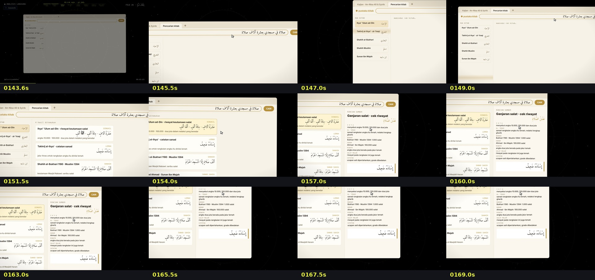
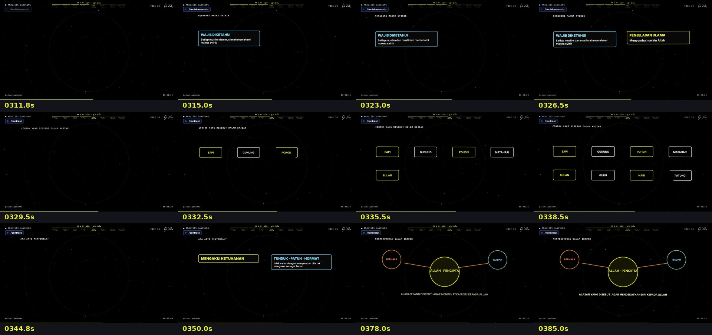
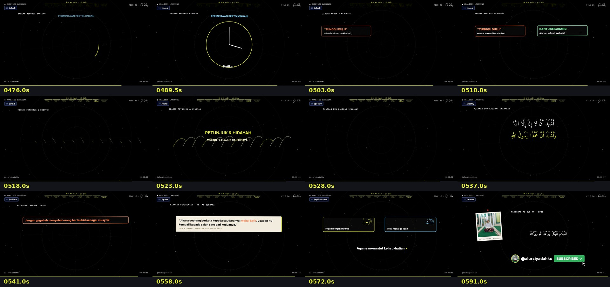

# Storyboard Ep26 — Mengenal Al-Qur'an

**Judul kerja:** *Amal Sekecil Apa Pun Dicatat Allah*

**Subjudul:** Surah An-Nisa 40 & 48 · Kebaikan, Syirik, dan Kehati-hatian Bertauhid

**Durasi sumber:** 9:57.786 · **Master:** 1920×1080, 30 fps, 16:9
**Gaya:** kelanjutan desain seri (hitam/navy, aksen kuning `#e9f23a`, editorial 2D, teks Arab dan Indonesia, ilustrasi garis/SVG; tanpa 3D, musik latar, atau penggambaran Nabi/sahabat). Foto user yang sudah disetujui dipakai sebagai foto penyampai di pembuka/penutup dengan framing seluruh badan.

| Waktu audio | Informasi adegan | Gerak dan fokus visual | Hold frame / baca | Audio & transisi |
|---|---|---|---|---|
| 00:00–00:24 | Lanjutan Surah An-Nisa; atsar Ibnu Mas'ud tentang lima ayat yang sangat berharga | Pembuka identitas Ep26, polaroid PENYAMPAI; lima penanda ayat menjadi garis bab, penanda ayat 40 disorot | **00:18** — lima indeks ayat tampil; 40 menjadi fokus | Suara asli + SFX halus; reveal tipografi |
| 00:24–01:21 | QS An-Nisa:31 sebagai pengantar, lalu An-Nisa:40 | Halaman naskah krem, kutipan ayat Arab muncul per kata; visual skala atom/zarrah berkembang menjadi angka pahala yang berlipat | **01:05** — frasa “Allah tidak menzalimi seberat zarrah” dan “melipatgandakan kebaikan” terbaca bersama | Wipe tulisan Arab, ketukan SFX pada kata kunci |
| 01:21–02:23 | Batu kecil di jalan, catatan amal, kebaikan dan dosa, hisab serta taubat | Batu kecil di jalur waktu sepuluh tahun; garisnya masuk ke buku amal abstrak. Lajur kebaikan dan kesalahan dibedakan; akhir adegan membuka pintu taubat | **01:42** — batu tercatat sebagai amal baik, meski pelakunya lupa | Garis waktu menggambar, lalu halaman berganti |
| 02:23–03:16 | Keutamaan salat di Masjid Nabawi dan Masjidil Haram | Dua skala perbandingan yang bersih, simbol masjid sebagai geometri abstrak tanpa figur | **02:55** — kartu sumber membedakan riwayat yang disebut penyampai dari riwayat sahih | Satu tab “◆ pustaka kitab”, tur kamera, 4 hasil dan panel rincian 7 baris |
| 03:16–04:20 | Salat di wilayah ribath dan dua rakaat malam | Peta batas abstrak tanpa peta politik; berpindah ke jam malam dan dua rakaat di ruang sunyi. Klaim angka dari jalur lemah diberi status sumber yang jelas | **03:57** — dua rakaat malam, niat ikhlas; label status riwayat terlihat | Audio asli dipertahankan; transisi dari garis batas ke lingkar jam |
| 04:20–05:11 | QS An-Nisa:48 tentang syirik dan ampunan | Ayat Arab menjadi fokus; cabang visual “syirik” dan “yang di bawahnya” dengan label “bagi siapa yang Allah kehendaki” | **04:37** — ayat 48 tampil utuh, sumber ayat terbaca | Musik tidak ditambahkan; hold lebih panjang untuk ayat |
| 05:11–06:00 | Uraian penyampai tentang makna menyembah dan mengakui ketuhanan | Grid simbol abstrak untuk benda-benda yang disebut (tanpa menggambarkan sosok suci); pasangan “tunduk/menghormati” dan “mengakui ketuhanan” dibedakan | **05:49** — fokus definisi “mengakui ketuhanan” | Ikon masuk satu per satu, latar tetap tenang |
| 06:00–06:30 | Menyekutukan Allah dalam ibadah; contoh Quraisy yang mengakui Allah sebagai Pencipta | Diagram dua arah menyusut menjadi satu pusat tauhid; tidak ada rekonstruksi figur atau adegan sejarah | **06:19** — satu pusat “Allah sebagai Pencipta”, dengan simbol sembahan lain dipisah dari penghambaan | Panah dan garis relasi, bukan adegan dramatis |
| 06:30–07:10 | Keyakinan tentang sebab, makan, obat, dan kehendak Allah | Diagram sebab-akibat: sarana (makan/obat) menuju hasil, namun kuasa penciptaan/penyembuhan ditandai milik Allah; tidak mengesankan meninggalkan ikhtiar | **06:56** — “gunakan sebab” terpisah dari “meyakini sebab berkuasa sendiri” | Jalur garis sederhana, penekanan kata demi kata |
| 07:10–07:55 | Menetapkan sekutu, anak/istri, sifat yang tidak layak; niat dan rida pada syirik | Lingkar eksklusivitas tauhid lalu cabang contoh konseptual dari ucapan penyampai; tampilan tidak menambah fatwa atau label kepada orang tertentu | **07:37** — larangan menganggap ada sekutu bagi Allah; label “peringatan akidah” | Gerak minimal dan jeda baca; transisi bersih |
| 07:55–08:38 | Contoh merestui syirik dan menunda bantuan saat seseorang meminta diajari masuk Islam | Dua kartu membedakan ucapan yang merestui syirik dari kewajiban membantu tanpa menunda; tanpa menggambarkan calon muslim atau figur | **08:18** — contoh “tunggu selesai makan/khutbah” dan akibatnya terbaca | SFX lembut; transisi bersih ke doa hidayah |
| 08:38–09:00 | Doa agar orang yang belum Islam mendapat hidayah, lalu ajarkan syahadat segera bila diminta | Jalur hidayah menuju teks dua kalimat syahadat; tanpa representasi Allah atau calon muslim | **08:52** — dua kalimat syahadat dan ajakan membantu saat itu juga terbaca | Cahaya garis, lalu hard transition ke peringatan |
| 09:00–09:44 | Peringatan keras tentang melabeli orang bertauhid sebagai musyrik/kafir | Kata-kata yang berbahaya berhenti di batas visual; kutipan hadis Bukhari tentang ucapan “wahai kafir” dan dua sisi kehati-hatian. Fokus pada larangan sembrono, bukan menunjuk individu | **09:27** — kutipan pendek dan sumber Bukhari tampil; “berhati-hati dalam takfir” terbaca | SFX ditahan agar pesan serius; tidak ada visual agresif |
| 09:44–09:57.786 | Salam dan penutup | Polaroid penyampai, avatar @alurziyadahku, Subscribe → Subscribed ✓; bar kemajuan berakhir | **09:52** — identitas kanal dan salam penutup | Audio rekaman asli; fade gambar/audio terakhir 1,4 detik |

### Lembar kontak pratinjau

Tab pencarian sumber:

Bagian konsep syirik dan tauhid:

Penutup dan peringatan takfir:

## Penguncian editorial

- Isi ucapan penyampai tidak akan dipotong atau ditulis ulang. Status sumber dan derajat riwayat ditampilkan sebagai konteks terpisah, tidak dengan mengubah transkrip di layar.
- Angka ganjaran salat yang diperselisihkan akan diberi label kualitas riwayat. Sumber sahih yang relevan ditampilkan tersendiri, dengan atribusi yang jelas.
- Grafis terkait syirik/takfir dibuat hati-hati: tidak menggambarkan Nabi/sahabat/Allah, tidak menarget orang atau kelompok masa kini, dan tetap memuat peringatan agar tidak gegabah memberi label kafir/musyrik.
- Master mengikuti standar seri: 20–30 kode visual, pergantian informasi mengikuti ucapan; seluruh daftar teks diperiksa dengan `overlap.js` sebelum sekali render penuh.
- Audio: hanya suara rekaman asli dan SFX ringan; tanpa musik/dengung latar.
