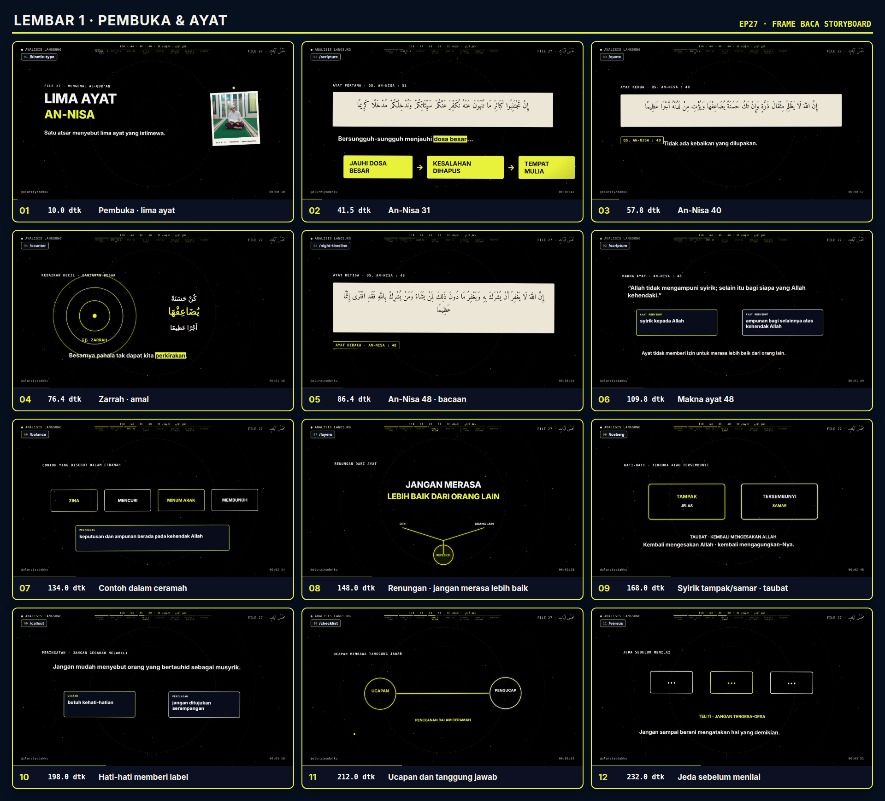
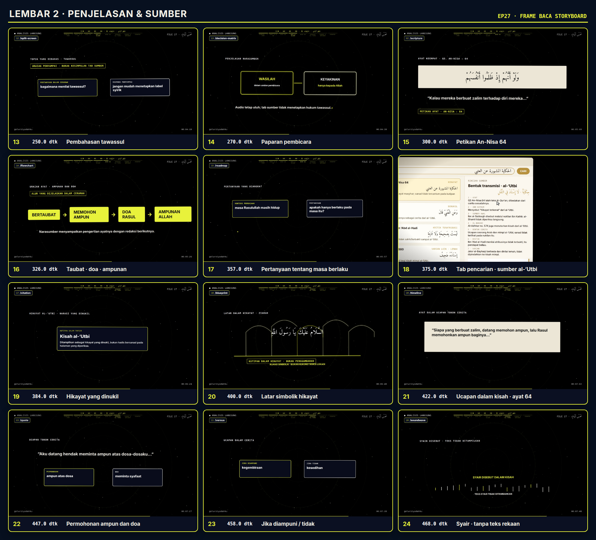
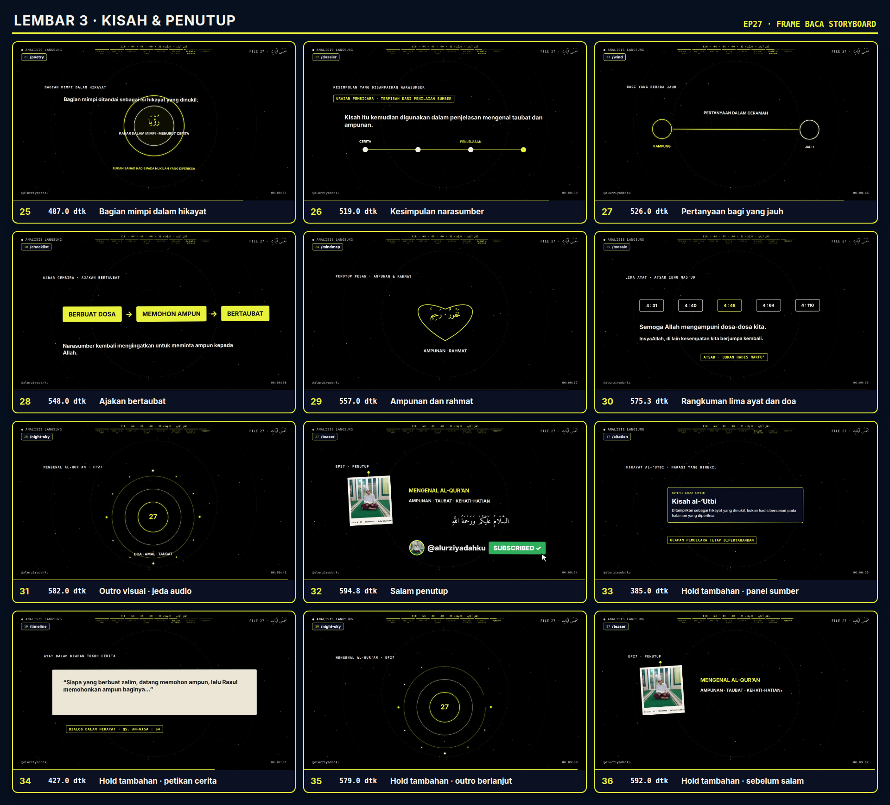

# Storyboard Ep27 — Lima Ayat Surah An-Nisa

**Status:** siap ditinjau; video penuh belum dirender.  
**Master rencana:** 1920×1080, 30 fps, durasi 09:56,82.  
**Audio:** rekaman asli dipertahankan; tanpa musik atau dengung; hanya SFX yang diselaraskan pada gerak visual.

## Lembar kontak storyboard

## Rangkaian adegan

| # | Timecode | Kode visual | Beat audio dan visual / hold frame |
|---:|:---|:---|:---|
| 01 | 00:00,0–00:24,5 | `/kinetic-type` | Pembuka “LIMA AYAT · AN-NISA”; foto penyampai dalam polaroid; lima nomor ayat muncul berurutan mengikuti pengantar. |
| 02 | 00:24,5–00:45,3 | `/scripture` | Teks Arab QS An-Nisa 31 pada panel krem; sorot makna menjauhi dosa besar, penghapusan kesalahan, dan tempat mulia. |
| 03 | 00:45,3–00:58,8 | `/quote` | QS An-Nisa 40; kutipan terjemahan tentang tidak ada kebaikan yang luput, tanpa tambahan klaim di luar ayat. |
| 04 | 00:58,8–01:17,9 | `/counter` | Titik kecil sebagai zarrah, lingkaran bertambah, dan teks Arab ayat; menegaskan ukuran amal yang kecil dan ganjaran besar sebagaimana audio. |
| 05 | 01:17,9–01:26,8 | `/night-timeline` | QS An-Nisa 48 dibaca; panel ayat tetap terisi selama jeda transkrip, tanpa menyisipkan narasi baru. |
| 06 | 01:26,8–01:56,4 | `/scripture` | Makna An-Nisa 48 disajikan dengan dua kartu ringkas: syirik dan ampunan bagi selainnya menurut kehendak Allah; ditutup pengingat agar tidak merasa lebih baik. |
| 07 | 01:56,4–02:20,5 | `/balance` | Contoh dosa yang memang disebut dalam ceramah muncul sebagai empat kartu netral; tidak ada orang atau kelompok yang disasar. |
| 08 | 02:20,5–02:36,0 | `/layers` | Renungan “jangan merasa lebih baik dari orang lain”; cabang grafis mengarahkan refleksi kepada diri sendiri. |
| 09 | 02:36,0–03:00,0 | `/iceberg` | Perbandingan “tampak” dan “tersembunyi” untuk menjelaskan kehati-hatian; taubat dan pengesaan Allah menjadi arah kembali. |
| 10 | 03:00,0–03:22,1 | `/callout` | Peringatan agar tidak mudah menyebut orang bertauhid sebagai musyrik; kartu menekankan kehati-hatian dan larangan penilaian serampangan. |
| 11 | 03:22,1–03:42,1 | `/checklist` | Diagram hubungan antara ucapan dan orang yang mengucapkannya; visual mengikuti penekanan tanggung jawab dalam ceramah. |
| 12 | 03:42,1–04:00,3 | `/versus` | Tiga kartu elipsis menjadi jeda visual sebelum menilai; tidak mengisi nama atau label pada siapa pun. |
| 13 | 04:00,3–04:21,3 | `/split-screen` | Topik tawassul disajikan sebagai pertanyaan dalam ceramah; respons penyampai dibedakan jelas dari kesimpulan tab sumber. |
| 14 | 04:21,3–04:40,7 | `/decision-matrix` | Diagram membedakan wasilah dalam penjelasan pembicara dan keyakinan kepada Allah; tidak memutuskan perbedaan hukum tawassul. |
| 15 | 04:40,7–05:04,5 | `/scripture` | Petikan QS An-Nisa 64 yang dibaca tampil pada panel krem bersama terjemahan ringkas dan rujukan ayat. |
| 16 | 05:04,5–05:46,0 | `/flowchart` | Urutan taubat, memohon ampun, doa Rasul, dan ampunan Allah ditandai sebagai alur yang dijelaskan dalam ceramah. |
| 17 | 05:46,0–06:06,2 | `/roadmap` | Pertanyaan tentang masa Rasulullah masih hidup dan apakah penerapannya hanya berlaku pada masa itu; dua kartu memandu konteks pertanyaan. |
| 18 | 06:06,2–06:17,4 | `/search` | Satu tab berlabel “◆ pustaka kitab”: lima rak, empat hasil, dan panel rincian tujuh poin; tur kamera menyorot kotak cari, rak, hasil, rincian, lalu kutipan. Nama perpustakaan sumber tidak ditampilkan. |
| 19 | 06:17,4–06:30,5 | `/citation` | Kisah al-‘Utbi ditandai sebagai hikayat yang dinukil; bukan hadis bersanad pada bagian halaman yang diperiksa. |
| 20 | 06:30,5–06:50,4 | `/blueprint` | Lengkung abstrak melambangkan latar cerita, bukan makam atau lokasi tertentu; kutipan Arab tetap diberi konteks sebagai bagian hikayat. |
| 21 | 06:50,4–07:12,9 | `/timeline` | Petikan An-Nisa 64 yang muncul dalam dialog tokoh cerita dibingkai sebagai ucapan di dalam kisah, bukan rekonstruksi tokoh. |
| 22 | 07:12,9–07:30,8 | `/quote` | Ucapan permohonan ampun ditampilkan sebagai dialog hikayat; dua kartu memisahkan permohonan ampun dan doa. |
| 23 | 07:30,8–07:40,9 | `/versus` | Dua keadaan dalam cerita—jika diampuni dan jika tidak—diwakili kartu abstrak, tanpa menggambar Nabi atau makhluk gaib. |
| 24 | 07:40,9–07:55,3 | `/soundwave` | Ketika syair disebut, waveform dekoratif saja; lirik yang tidak tersedia atau kurang pasti tidak direka. |
| 25 | 07:55,3–08:19,1 | `/poetry` | Bagian mimpi ditandai tegas sebagai isi hikayat; tidak ada visual Nabi atau tokoh mimpi, dan tidak dinyatakan sebagai sanad hadis. |
| 26 | 08:19,1–08:41,7 | `/dossier` | Kesimpulan yang disampaikan narasumber dipisahkan secara visual dari penilaian sumber; garis waktu menghubungkan cerita dengan penjelasan. |
| 27 | 08:41,7–08:52,9 | `/wind` | Pertanyaan bagi orang yang berada jauh divisualkan dengan dua titik abstrak; tanpa peta dunia atau rekonstruksi tempat. |
| 28 | 08:52,9–09:11,8 | `/checklist` | Ajakan memohon ampun dan bertaubat ditampilkan sebagai urutan langkah, selaras dengan ucapan penyampai. |
| 29 | 09:11,8–09:22,2 | `/mindmap` | Pesan ampunan dan rahmat melalui simbol garis hati abstrak; tidak menambah kutipan ayat baru. |
| 30 | 09:22,2–09:35,7 | `/mosaic` | Lima nomor ayat dirangkum; An-Nisa 48 disorot pada frame hold; label menyatakan atsar, bukan hadis marfu‘. Doa dan kalimat penutup tampil penuh pada hold 09:35,3. |
| 31 | 09:35,7–09:49,8 | `/night-sky` | Outro visual abstrak mengisi jeda audio; tidak ditambahkan narasi, musik, dengung, atau teks yang tidak diucapkan. |
| 32 | 09:49,8–09:56,82 | `/teaser` | Polaroid penyampai, nama seri, salam Arab, dan tombol kanal; potongan transkrip yang ditandai kurang pasti pada 09:49,8–09:53,0 tidak ditampilkan sebagai kutipan. |

## Batas editorial dan sumber

Audio penyampai tidak ditulis ulang atau dipotong. Frasa yang ditandai kurang pasti pada 00:15,1–00:16,5 dan 09:49,8–09:53,0 tidak dijadikan teks kutipan; syair yang tidak tersedia juga tidak ditebak. Visual tidak menggambarkan Allah, Nabi, Sahabat, atau tokoh dalam kisah, dan tidak menyasar individu maupun kelompok masa kini.

Tab sumber menempatkan QS An-Nisa 64 terpisah dari cerita al-‘Utbi. Ibn Kathir menukilnya sebagai “hikayat terkenal” tanpa sanad yang tampak pada kutipan; al-Nawawi juga menuturkannya sebagai cerita. Penilaian “tidak sahih/tidak terbukti sampai kepada al-‘Utbi” diatribusikan khusus kepada Ibn ‘Abd al-Hadi, bukan disebut sebagai ijmak. Varian jalur al-Bayhaqi tidak dipindahkan menjadi sanad kisah mimpi al-‘Utbi. Rincian dan URL ada di [dossier cek sumber](CEK_SUMBER_EP27.md).

**Pemeriksaan sebelum storyboard:** sintaks JavaScript dan shell lulus; `overlap.js` diperiksa pada empat rentang sepanjang durasi dengan langkah 0,5 detik dan menemukan 0 baris benturan. Tidak ada layar kosong lebih dari dua detik pada preview yang diperiksa. Ini masih prarender; hasil MP4 final belum dibuat.
