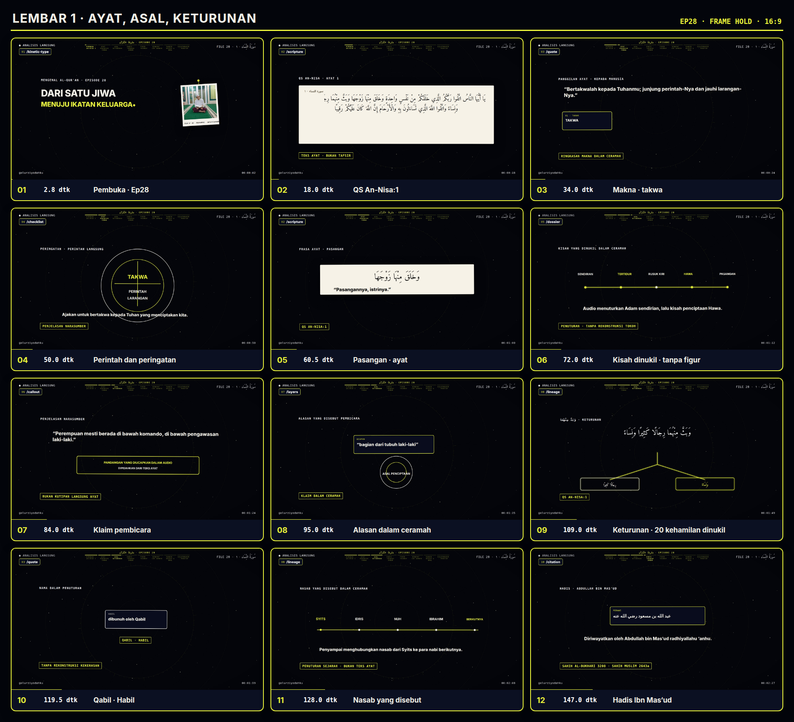
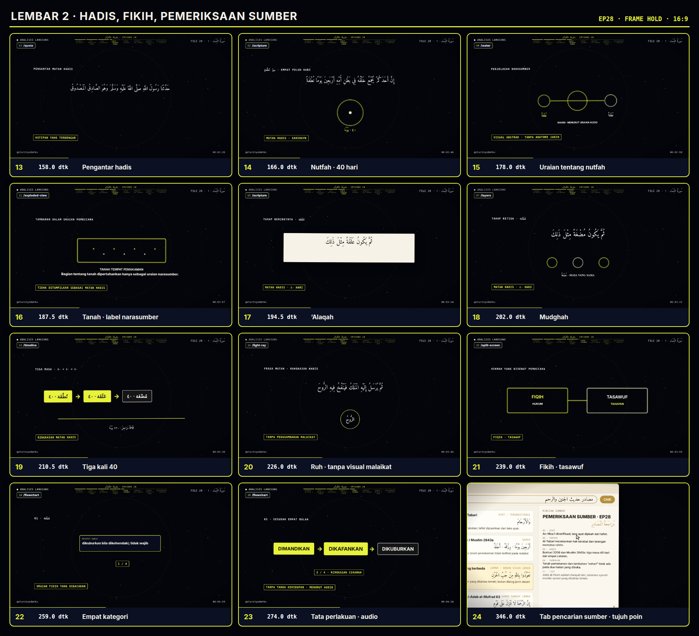
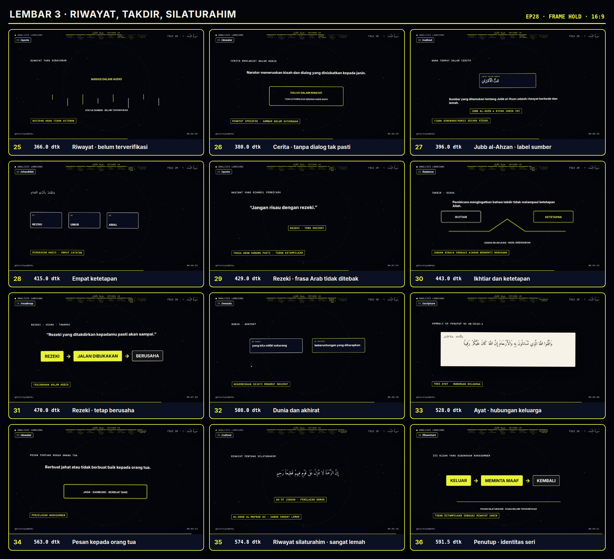

# Storyboard Ep28 — Mengenal Al-Qur’an

**Tema:** QS An-Nisa:1, asal penciptaan, takdir, dan silaturahim.  
**Durasi sumber:** 09:59,8. **Format rencana:** 1920×1080, 30 fps.  
**Audio:** MP3 asli utuh, tanpa musik atau dengung; hanya SFX yang mengikuti perubahan visual.  
**Rencana visual:** 59 adegan bertimestamp dan 29 kode visual unik (rentang standar seri 20–30), satu tag aktif pada satu waktu. Perubahan kartu, penekanan, dan elemen mengikuti kata/beat di dalam setiap adegan.  
**Batas representasi:** tidak menggambar Allah, Nabi, Sahabat, malaikat, janin yang menderita, neraka, atau kekerasan. Ayat/hadis dipisahkan dari tafsir, penuturan, dan penjelasan pembicara. Teks Arab yang kurang pasti tidak ditebak.  
**Dossier:** [Catatan pemeriksaan sumber Ep28](CEK_SUMBER_EP28.md).

## Lembar kontak

## Urutan adegan

| # | Rentang | Kode visual | Beat ujaran dan visual | Batas sumber / penyajian |
|---:|---|---|---|---|
| 01 | 00:00.0–00:11.0 | `/kinetic-type` | Bismillah, judul episode, “Dari satu jiwa menuju ikatan keluarga”; foto penyampai dalam polaroid berjarak. | Foto pembuka diberi label PENYAMPAI; tidak ada musik. |
| 02 | 00:11.0–00:27.5 | `/scripture` | QS An-Nisa:1 dibaca utuh pada panel kertas krem. | Teks ayat diberi label ayat, bukan tafsir. |
| 03 | 00:27.5–00:45.7 | `/quote` | Makna seruan takwa; tiga kartu “takwa, junjung perintah, jauhi larangan” muncul bertahap. | Ringkasan makna ceramah, bukan kutipan tambahan ayat. |
| 04 | 00:45.7–00:57.4 | `/checklist` | Takwa diletakkan di tengah, lalu perintah dan larangan mengelilinginya. | Dilabeli sebagai penjelasan narasumber. |
| 05 | 00:57.4–01:03.7 | `/scripture` | Frasa ayat tentang pasangan, lalu terjemahan pendek. | QS An-Nisa:1. |
| 06 | 01:03.7–01:18.7 | `/dossier` | Beat kisah Adam sendirian hingga kisah penciptaan Hawa; garis waktu abstrak tanpa figur. | Kisah yang dinukil dalam ceramah, bukan adegan sejarah yang direkonstruksi. |
| 07 | 01:18.7–01:29.6 | `/callout` | Pernyataan pembicara tentang komando/pengawasan ditampilkan sebagai kutipan audio. | Diberi label “bukan kutipan langsung ayat”; tidak disajikan sebagai tafsir terverifikasi. |
| 08 | 01:29.6–01:41.7 | `/layers` | Alasan yang disebut pembicara divisualkan sebagai satu kartu dan lingkaran asal penciptaan. | Klaim dalam ceramah; tidak digabungkan dengan teks wahyu. |
| 09 | 01:41.7–01:57.6 | `/lineage` | Frasa ayat tentang berkembangnya laki-laki dan perempuan; cabang abstrak muncul kiri–kanan. | Frasa diberi rujukan QS An-Nisa:1. |
| 10 | 01:57.6–02:02.0 | `/quote` | Nama Qabil dan Habil; satu kartu nama tanpa adegan kekerasan. | Penuturan sejarah dalam audio. |
| 11 | 02:02.0–02:14.2 | `/lineage` | Syits, Idris, Nuh, Ibrahim, dan “berikutnya” tersusun pada garis nasab. | Urutan yang disebut penyampai; bukan teks ayat. |
| 12 | 02:14.2–02:20.1 | `/water` | Transisi visual ke kata kunci nutfah. | Tidak ada anatomi atau penggambaran janin. |
| 13 | 02:20.1–02:34.1 | `/citation` | Perawi Abdullah bin Mas‘ud diperkenalkan sebelum matan. | Sahih al-Bukhari 3208 dan Sahih Muslim 2643a. |
| 14 | 02:34.1–02:39.6 | `/quote` | Pengantar matan hadis yang terdengar. | Kutipan dibatasi pada lafaz yang jelas. |
| 15 | 02:39.6–02:52.9 | `/scripture` | Nutfah dan 40 hari pertama; lingkaran abstrak menandai masa. | Matan hadis Sahihayn. |
| 16 | 02:52.9–03:03.0 | `/water` | Penjelasan narasumber tentang nutfah dengan titik dan lingkaran abstrak. | Bukan anatomi janin dan bukan kutipan matan. |
| 17 | 03:03.0–03:12.0 | `/exploded-view` | Tambahan tentang tanah tempat pemakaman divisualkan sebagai butiran abstrak. | Dinyatakan sebagai uraian pembicara; tidak ditempelkan ke matan Bukhari/Muslim yang diperiksa. |
| 18 | 03:12.0–03:17.9 | `/scripture` | Frasa ‘alaqah pada kertas krem dengan terjemahan. | Bagian matan hadis tentang masa yang sama. |
| 19 | 03:17.9–03:25.2 | `/layers` | Frasa mudghah; tiga lingkaran abstrak menyusul. | Bagian matan hadis, bukan ilustrasi biologis. |
| 20 | 03:25.2–03:36.7 | `/timeline` | Tiga tahap 40 + 40 + 40 disusun sebagai urutan kiri ke kanan. | Ringkasan matan; tidak menambah tahapan biologis. |
| 21 | 03:36.7–03:41.6 | `/blueprint` | Transisi singkat “alur berlanjut” menuju frasa berikutnya. | Penjelasan pembicara. |
| 22 | 03:41.6–03:49.6 | `/light-ray` | Frasa tentang malaikat dan ruh ditampilkan sebagai teks dengan halo abstrak. | Tidak menggambarkan malaikat. |
| 23 | 03:49.6–03:55.1 | `/quote` | “Empat bulan atau lebih sehari” muncul sebagai satu kutipan narasumber. | Tidak ditambahkan ke matan hadis yang diperiksa. |
| 24 | 03:55.1–04:02.5 | `/split-screen` | Fikih dan tasawuf menjadi dua panel pengantar. | Penghubung sesuai ucapan. |
| 25 | 04:02.5–04:11.0 | `/decision-matrix` | Pertanyaan tentang perlakuan terhadap kandungan yang gugur. | Uraian narasumber. |
| 26 | 04:11.0–04:16.6 | `/counter` | Empat penanda kategori muncul satu demi satu. | Ringkasan penjelasan dalam audio, bukan fatwa universal. |
| 27 | 04:16.6–04:23.7 | `/flowchart` | Kategori pertama: mudghah; kartu teks dan penanda 1/4. | Pendapat fikih yang dibacakan; tidak dijadikan saran medis. |
| 28 | 04:23.7–04:31.1 | `/flowchart` | Kategori kedua: urutan “berbentuk → dikafankan → dikuburkan”. | Syarat dan kata “wajib” dilabeli sebagai ucapan narasumber. |
| 29 | 04:31.1–04:40.0 | `/flowchart` | Kategori ketiga: setelah empat bulan, tanpa tanda kehidupan; urutan perlakuan muncul bertahap. | Ringkasan ceramah; bukan pedoman medis. |
| 30 | 04:40.0–04:49.0 | `/checklist` | Kategori keempat: tanda kehidupan; lingkaran 4/4 dan ringkasan. | Tegas diberi catatan “bukan panduan medis/fatwa kasus pribadi”. |
| 31 | 04:49.0–04:59.1 | `/ladder` | Tiga anak tangga 40 hari untuk analogi tasawuf. | Analogi yang disebut pembicara. |
| 32 | 04:59.1–05:07.9 | `/poetry` | Garis bertahap menuju ma‘rifat dengan kata “analogi tasawuf”. | Bukan grafik biologis atau dalil mandiri. |
| 33 | 05:07.9–05:21.3 | `/scripture` | Kartu ikhlas, kedekatan, dan ibadah muncul seirama contoh perenungan. | Frasa ditampilkan sebagai kata kunci yang disebut penyampai. |
| 34 | 05:21.3–05:33.3 | `/dossier` | Klaim pembicara tentang pengguguran kandungan yang sudah hidup; kartu status dalil. | Diberi label penjelasan narasumber; status dalil yang dikutip belum dipastikan. |
| 35 | 05:33.3–05:59.7 | `/search` | Satu tab pencarian sumber: ayat/tafsir, hadis Sahihayn, kisah Jubb yang berbeda, dan riwayat silaturahim. Kamera menyorot hasil dan panel tujuh poin. | Tab berlabel “◆ pustaka kitab”; nama perpustakaan tidak tampil. Status sumber disajikan terpisah dari audio. |
| 36 | 05:59.7–06:09.9 | `/quote` | Narasi berlanjut dengan penanda abstrak dan status sumber. | Lafaz Arab yang kurang pasti tidak ditebak; riwayat spesifik belum terverifikasi. |
| 37 | 06:09.9–06:27.5 | `/dossier` | Dialog yang dinisbatkan kepada janin dibatasi dalam kotak dossier, tanpa merekonstruksi tokoh atau adegan. | Sumber tepat belum ditemukan; tidak disajikan sebagai hadis sahih. |
| 38 | 06:27.5–06:42.8 | `/callout` | Nama Jubb al-Ahzan dalam audio, lalu catatan pembeda Jubb al-Huzn. | Riwayat Jubb al-Huzn yang ditemukan berbeda dan lemah; tidak disamakan dengan kisah janin. |
| 39 | 06:42.8–06:49.9 | `/timeline` | Garis lima titik mengantar kembali ke empat catatan hadis. | Transisi visual. |
| 40 | 06:49.9–06:59.9 | `/checklist` | Empat kartu bernomor: rezeki, umur, amal, sa‘id/syaqi. | Empat catatan dalam Sahih al-Bukhari 3208 dan Sahih Muslim 2643a. |
| 41 | 06:59.9–07:04.6 | `/counter` | Sa‘id dan syaqi dipisah dalam dua panel. | Frasa status akhirat dari matan hadis. |
| 42 | 07:04.6–07:10.9 | `/quote` | Nasihat “jangan risau dengan rezeki”; kartu tema. | Makna Indonesia saja; lafaz Arab yang kurang pasti tidak ditampilkan. |
| 43 | 07:10.9–07:16.2 | `/counter` | Dua panel “sedikit” dan “banyak” dihubungkan garis. | Penjelasan narasumber. |
| 44 | 07:16.2–07:32.6 | `/balance` | Ikhtiar dan ketetapan disusun seimbang; garis hasil berada di antara keduanya. | Tidak dibaca sebagai ajakan berhenti berusaha. |
| 45 | 07:32.6–07:42.9 | `/night-timeline` | Kata tema rezeki berada di tengah lingkaran; tidak ada rekonstruksi lafaz Arab. | Kutipan kurang pasti tidak direka. |
| 46 | 07:42.9–07:57.8 | `/roadmap` | Urutan “rezeki → jalan dibukakan → berusaha”, lalu tawakal. | Terjemahan dan nasihat dalam audio. |
| 47 | 07:57.8–08:04.8 | `/versus` | Panel “celaka atau beruntung” mengantar nasihat berhati-hati. | Nasihat pembicara, bukan jaminan hasil individual. |
| 48 | 08:04.8–08:17.8 | `/quote` | Pesan agar tidak bergembira berlebihan sebelum mengetahui keadaan akhirat; halo seimbang. | Bahasa Indonesia saja untuk bagian Arab yang kurang pasti. |
| 49 | 08:17.8–08:38.0 | `/mosaic` | Dua kartu: yang dimiliki di dunia dan keberuntungan yang diharapkan di akhirat. | Ringkasan tema nasihat. |
| 50 | 08:38.0–08:41.7 | `/scripture` | Doa keselamatan di dunia dan akhirat. | Doa yang terdengar pada audio. |
| 51 | 08:41.7–08:52.2 | `/scripture` | Penutup QS An-Nisa:1 tentang takwa dan hubungan rahim pada panel ayat. | Teks ayat dipisahkan dari tafsir. |
| 52 | 08:52.2–09:01.8 | `/network` | Jaringan titik merangkum ikatan, hak, dan kebaikan keluarga. | Penjelasan pembicara. |
| 53 | 09:01.8–09:13.8 | `/wind` | Dua kartu contoh: menyakiti keluarga dan tidak berbuat baik kepada kerabat. | Contoh yang disebut narasumber. |
| 54 | 09:13.8–09:18.3 | `/lineage` | “Abah · Mama” sebagai kerabat terdekat, tanpa foto atau rekonstruksi keluarga. | Mengikuti audio. |
| 55 | 09:18.3–09:28.7 | `/dossier` | Pesan berbuat baik kepada orang tua; satu kartu ajakan menjaga dan menyambung. | Penjelasan narasumber. |
| 56 | 09:28.7–09:36.9 | `/callout` | Teks riwayat tentang rahmat dan pemutus silaturahim, disertai status. | Al-Adab al-Mufrad 63; penilaian yang diperiksa: sanad sangat lemah. |
| 57 | 09:36.9–09:45.1 | `/citation` | Kisah yang dinisbatkan kepada Ibn Mas‘ud muncul dalam kotak majelis. | Redaksi/sanad belum dipastikan; tidak dinyatakan sebagai hadis marfu‘ sahih. |
| 58 | 09:45.1–09:58.0 | `/flowchart` | Urutan “keluar → meminta maaf → kembali” menutup kisah tanpa menggambar hadirin. | Kisah dalam ceramah; tidak ditampilkan sebagai riwayat sahih. |
| 59 | 09:58.0–09:59.8 | `/teaser` | Outro seri: foto penyampai, identitas episode, ringkasan tema, dan tombol subscribe. | Penutup visual; MP3 tetap tidak dipotong. |

## Pemeriksaan sumber

Ayat QS An-Nisa:1 dan tafsir al-Tabari diperiksa. Hadis Ibn Mas‘ud tentang tiga masa 40 hari dan empat ketetapan cocok dengan Sahih al-Bukhari 3208 dan Sahih Muslim 2643a. Tambahan tanah tempat pemakaman dan “sehari” tidak ditempelkan pada matan yang diperiksa. Kisah janin berkata “aku yang dizalimi” belum terverifikasi; kisah Jubb al-Huzn yang ditemukan adalah riwayat berbeda dan dinilai lemah. Al-Adab al-Mufrad 63 tercatat, tetapi sanad riwayat “rahmat tidak turun...” dinilai sangat lemah. Rincian, URL, dan batas klaim ada dalam [dossier sumber](CEK_SUMBER_EP28.md).

## Hal yang diminta untuk ditinjau

Mohon tinjau alur 59 adegan, visual kisah yang belum terverifikasi, label sumber, serta ritme tiga lembar kontak sebelum render penuh. Belum ada render video penuh pada tahap storyboard ini.
